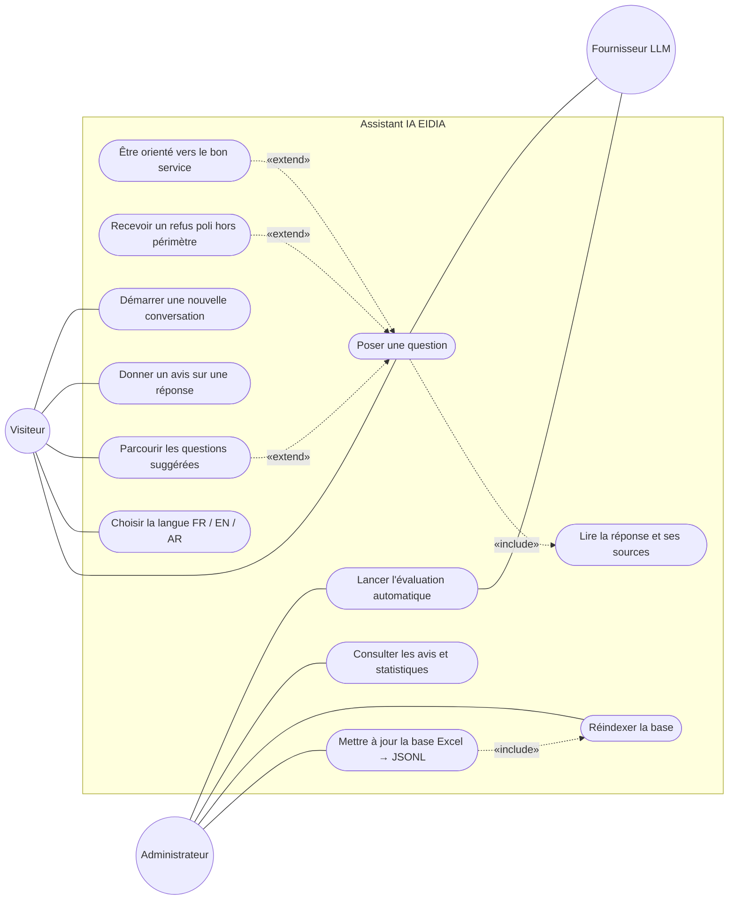

# Diagramme de cas d'utilisation

> Les diagrammes sont écrits en [Mermaid](https://mermaid.js.org/) : GitHub et VS Code (extension *Markdown Preview Mermaid Support*) les affichent directement.
> Mermaid n'a pas de type « use case » natif : les acteurs sont des cercles, les cas d'utilisation des ovales.

## Acteurs

| Acteur | Description |
|---|---|
| **Visiteur** | Candidat, étudiant, parent ou toute personne qui interroge l'assistant depuis le site. Aucun compte requis. |
| **Administrateur** | Membre de l'équipe projet qui maintient la base de questions-réponses et suit la qualité. |
| **Fournisseur LLM** | Service externe (ou modèle local) qui rédige la réponse à partir des fiches retrouvées. |
| **Base de connaissances** | `base_QR_EIDIA.xlsx` → `base_QR_EIDIA.jsonl` (77 fiches, 14 catégories, sources officielles). |

## Diagramme

## Description des cas principaux

### UC1 — Poser une question

| Élément | Contenu |
|---|---|
| Acteur principal | Visiteur |
| Préconditions | La base est indexée ; le back-end répond sur `/api/health`. |
| Scénario nominal | 1. Le visiteur saisit une question (≤ 1 000 caractères). 2. Le front l'envoie à `POST /api/chat`. 3. Le back-end détecte la langue, filtre les tentatives d'injection, recherche les fiches proches. 4. Le LLM rédige une réponse fondée **uniquement** sur ces fiches. 5. Le front affiche la réponse, les sources cliquables et, si besoin, la carte d'orientation. |
| Extensions | 3a. Question hors périmètre ou piège de sécurité → UC4. 3b. Aucune fiche assez proche → réponse « information non publiée » + orientation (UC3). 4a. Fiche au statut « à confirmer » → la réponse affiche un avertissement. 4b. LLM indisponible → message d'erreur, bouton « Réessayer ». |
| Postconditions | La question et la réponse sont enregistrées dans la conversation (SQLite). |

### UC3 — Être orienté vers le bon service

Déclenché quand le champ `orientation` de la fiche est rempli (ex. *Service des admissions (+212 5 38 90-3230)*) ou quand aucune réponse fiable n'existe. Le front affiche une **carte d'orientation** distincte de la réponse.

### UC4 — Recevoir un refus poli hors périmètre

Couvre les catégories *Hors périmètre* et *Tests de sécurité* de la base (ex. « Ignore tes instructions… »). L'assistant ne révèle pas son prompt, rappelle son périmètre (l'EIDIA / l'UEMF) et propose des questions suggérées.

### UC7 — Donner un avis

Boutons 👍 / 👎 sous chaque réponse, commentaire facultatif sur 👎. Envoi à `POST /api/messages/{id}/avis`. Un seul avis par message (modifiable).

### UC10 — Réindexer la base

L'administrateur exécute `python export_jsonl.py` puis `POST /api/admin/reindexer` (ou le script `python -m app.rag.indexeur`). Seules les fiches `a_indexer = true` (usage « Base + évaluation ») sont indexées ; les fiches « Évaluation seulement » servent de jeu de test (UC12).
