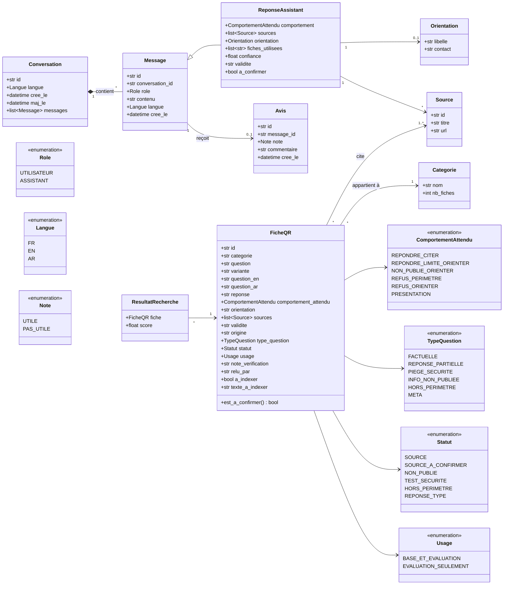
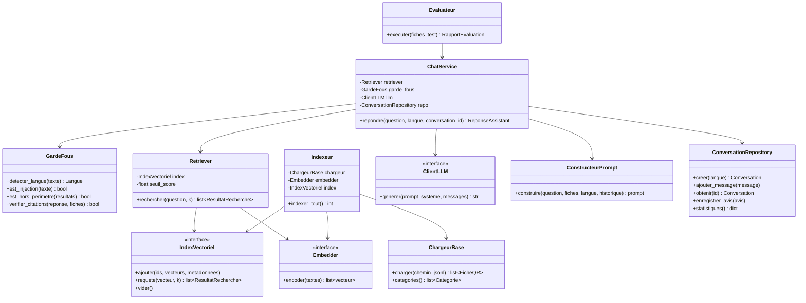
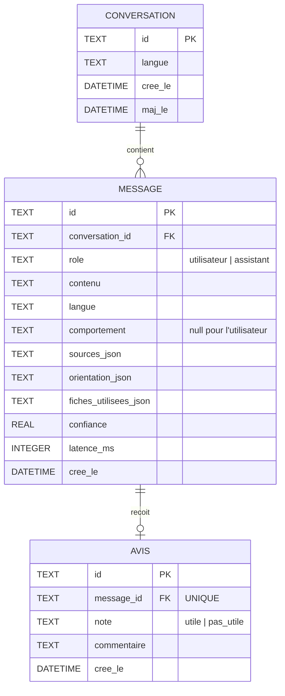
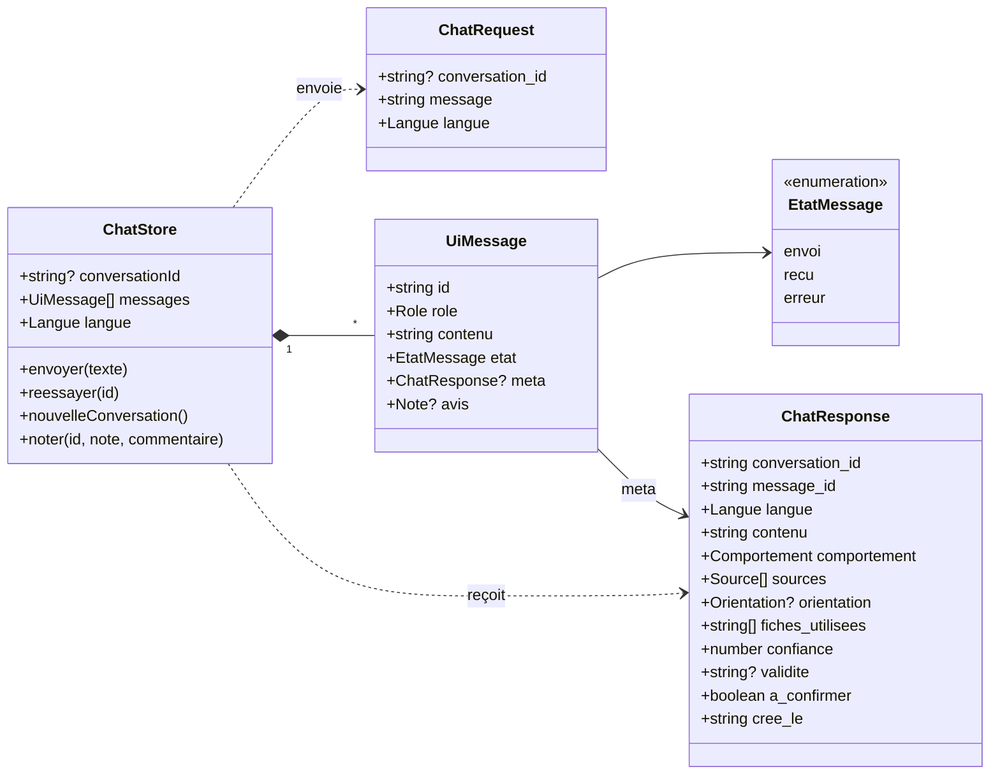

# Diagrammes de classes et modèle de données

## 1. Modèle du domaine (back-end)

Les attributs de `FicheQR` reprennent **exactement** les clés de `base_QR_EIDIA.jsonl` produites par `export_jsonl.py`.

### Correspondance valeurs Excel ↔ énumérations

| Valeur dans la base | Énumération API |
|---|---|
| Répondre et citer la source | `repondre_citer` |
| Répondre, signaler la limite et orienter | `repondre_limite_orienter` |
| Dire que l'info n'est pas publiée et orienter | `non_publie_orienter` |
| Refuser et rester dans le périmètre | `refus_perimetre` |
| Refuser poliment et orienter | `refus_orienter` |
| Présenter le périmètre | `presentation` |

## 2. Services du back-end

Les trois `<<interface>>` permettent de changer de fournisseur (modèle d'embeddings, base vectorielle, LLM) sans toucher au reste du code.

## 3. Modèle relationnel (SQLite) — conversations et avis

La base Q/R reste dans le JSONL + l'index vectoriel. SQLite ne stocke que ce que le prototype produit.

## 4. Types côté front-end (TypeScript)

