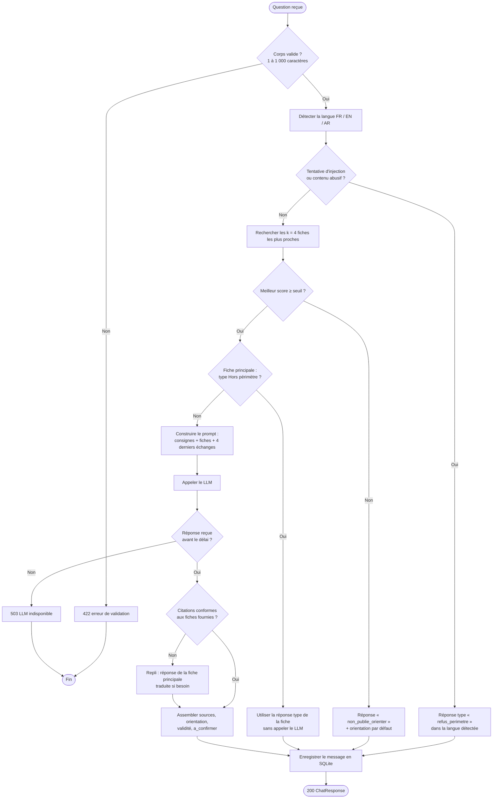
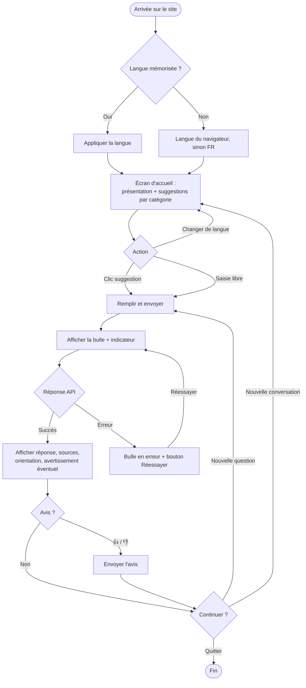
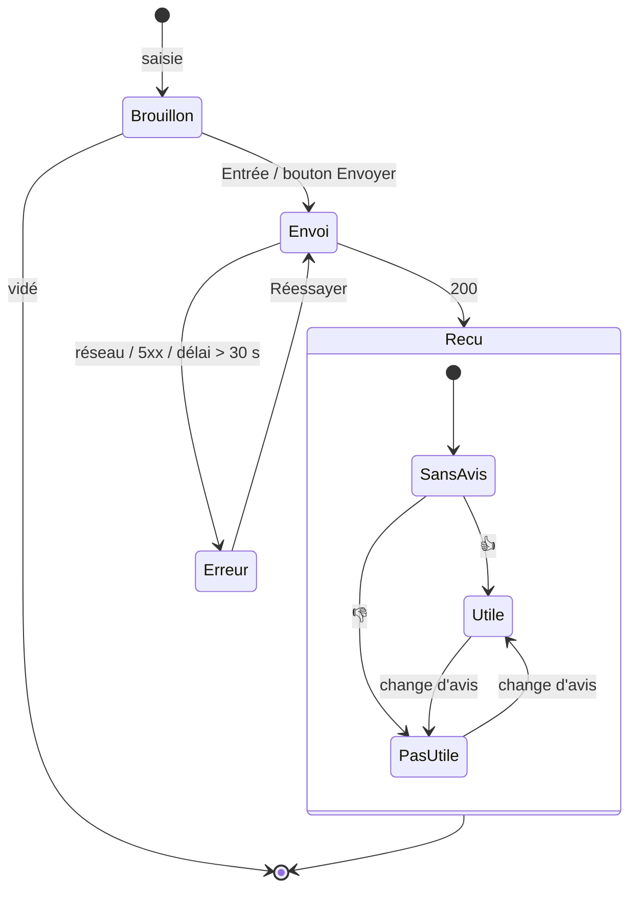
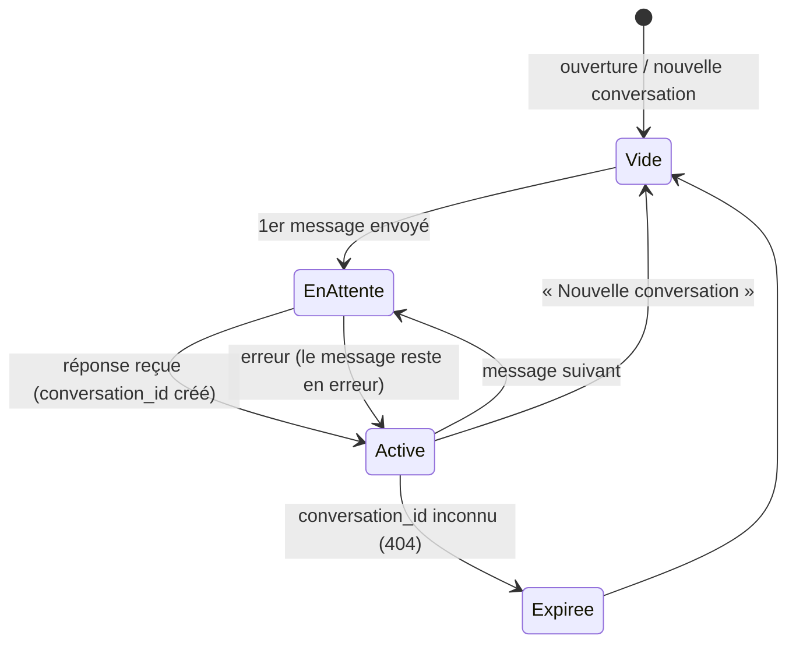

# Diagrammes d'activité et d'états

## 1. Activité — traitement d'une question (back-end)

## 2. Activité — parcours utilisateur (front-end)

## 3. États — un message côté front

## 4. États — la conversation

Pendant `EnAttente`, le champ de saisie reste éditable mais le bouton **Envoyer** est désactivé : un seul message en vol à la fois.
