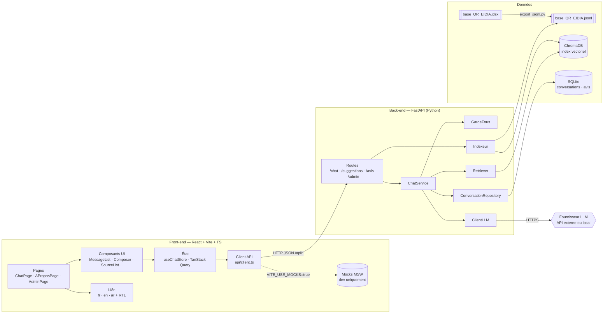
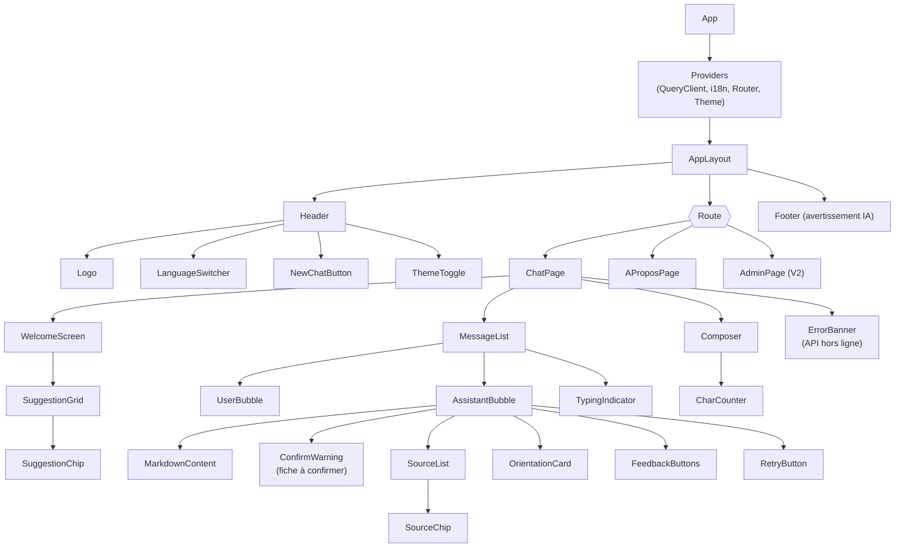
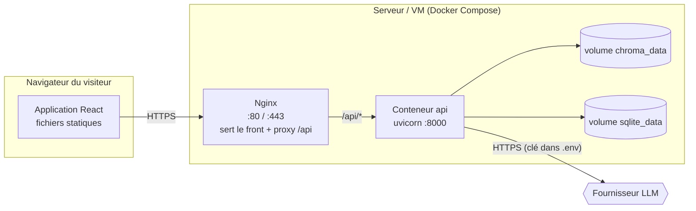

# Diagrammes de composants et de déploiement

## 1. Composants — vue d'ensemble

## 2. Composants — arbre React

## 3. Déploiement — prototype

En développement, pas de Nginx : `npm run dev` (port 5173) et `uvicorn --reload` (port 8000), le proxy Vite redirige `/api` vers le back-end — pas de souci de CORS.
